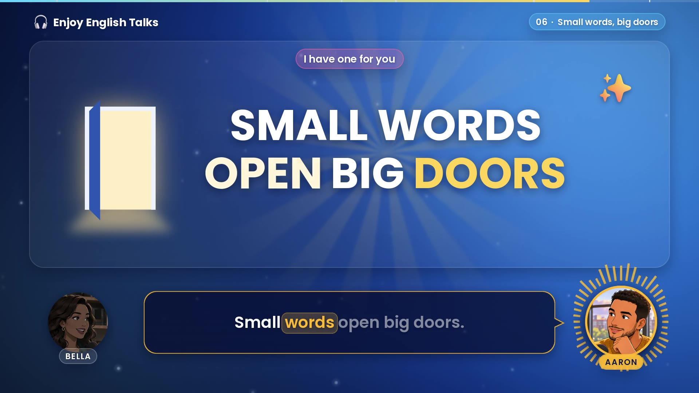

# Enjoy English Talks · Part 1 — motion-graphics video

`audio/qaybo_5min/qayb_00.mp3` (the first 5 minutes of the episode) turned into a 1920×1080, 30 fps motion-graphics video: **`output/enjoy_english_talks_part1.mp4`** (5:04).



## What's on screen

- **Who is talking.** Bella (pink) and Aaron (amber) sit at the bottom corners. The speaker's portrait grows and lights up, and a ring of bars moves with their voice. The caption bubble's tail points at them.
- **Captions.** Karaoke-style. Each word lights up in the speaker's colour as it is spoken; words not yet spoken are dimmed.
- **What they're talking about.** The board in the middle explains each part of the conversation with animated cards, icons, chat bubbles and headlines. They appear on the exact word they belong to. For example, the elevator counts up six floors and the door closes on "I closed the door". "Small words open big doors" bounces each time someone says it.
- **Chapters.** 01 Welcome · 02 The elevator moment · 03 Small talk is a skill · 04 A small request · 05 What is small talk? · 06 Small words, big doors · 07 5 easy ways. Each chapter opens with a wipe transition and a whoosh. The pill at the top right shows the current chapter, and the bar along the top edge shows progress.
- **Sound.** The voice is untouched. Soft pops mark new cards, plus an elevator ding, a record scratch after "I just said yes", crickets after "Nobody talked", clicks on like/subscribe/share, chimes, a door knock and a quiet lo-fi bed that ducks under the voice. The mix measures −17.5 LUFS, the same as the voice track.

## How it's built

| Step | File | Output |
|---|---|---|
| Word-level transcript (faster-whisper `medium.en`) | `transcribe.py` | `data/whisper_words.json` |
| Speaker per word (wespeaker embeddings), word edges snapped to the audio | `align.py` | `data/words.json` |
| Download icons, sound effects and music | `fetch_assets.py` | `assets/emoji`, `assets/audio` |
| Scenes and sound cues, keyed to spoken words | `storyboard.py` (elements in `scenes.py`, drawing in `gfx.py`) | — |
| Frames, captions, hosts, audio mix and mux | `render.py`, `mix.py` | `output/enjoy_english_talks_part1.mp4` |

```bash
pip install -r requirements.txt     # also needs ffmpeg
python transcribe.py && python align.py   # only if the audio changes; data/ is committed
python fetch_assets.py
python render.py --stills           # quick contact sheet: build/contact_sheet.png
python render.py                    # full video (about 3 minutes on 16 cores)
```

To change what appears on screen, edit `storyboard.py`. Cues like `cue("elevator", 33)` mean "when 'elevator' is next said after 33 s", so timings follow the voice automatically.

Credits are in `CREDITS.md`.
